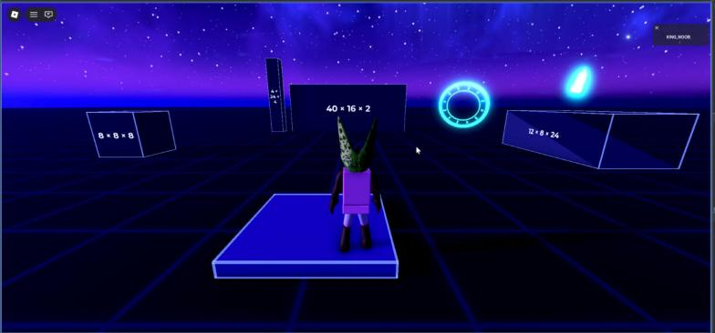

# Grid baseplate with reference props

**What it is:** A 2048×2048 dark baseplate with a grid texture, a spawn pad, four reference props (wall, ramp, block, pillar) with glowing outlines and their size in studs written on them, plus 6 floating crystal clusters and 3 rune rings (Blender meshes) that bob and spin. Good as a testing floor: the labelled props make scale easy to judge.

**Looks like:**

**Came from:** Baseplate, `Baseplate/src/shared/Sandbox/World.lua`, 2026-10-27

**Parameters:** `Config.World` in the Baseplate Config:
- `Baseplate.Size`, `GridStuds`, `GridTransparency`
- `Spawn`, `Props.*` (sizes, positions, `EdgeColor`)
- `Crystals` / `Runes`: count, radius, size, colors, bob, spin, `Transparency` (lower = stronger glow under Bloom)
- `StreamingEnabled`
- Asset ids from `Config.Assets`:

| Asset | Id | File here |
|---|---|---|
| GridTexture | 115000226789342 | `images/grid.png` |
| CrystalMesh | mesh 72994403954618 (model 117734321434501) | `meshes/crystal_cluster.fbx` |
| RuneRingMesh | mesh 118060293036777 (model 83840754337356) | `meshes/rune_ring.fbx` |

**Depends on:** `Assets.lua` (included: MeshPart with a plain Part fallback); the floating motion comes from `SkyAnimator.lua` in [[night-sky]] through the `SandboxFloat` / `SandboxSpin` tags; services Workspace, CollectionService

**Used in:** Baseplate, `src/shared/Sandbox/World.lua` (`World.build(Config)` on the server)

**Version:** 0.1

**Notes:**
- Builds into `workspace.SandboxWorld` and is safe to run again.
- The crystals, runes and frame needed Transparency 0.2 / 0.45 / 0.55 so Neon doesn't wash out under Bloom (see [[bloom-and-glow-tuning]]).
- The Blender source for both meshes is `Baseplate/assets/blender/sandbox_assets.blend` (scenes Crystal and RuneRing). `grid.png` is drawn by `make_images.py` in [[night-sky]].
