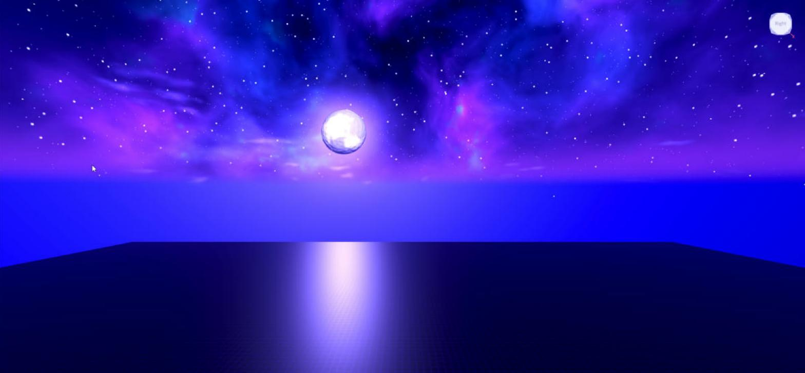

# Night sky

**What it is:** A purple and blue night sky built from Config: Lighting, post effects (ColorCorrection, Bloom, SunRays, light DepthOfField), Atmosphere, Clouds, a custom 6-face skybox (nebula band, stars, horizon glow), about 420 neon stars on a slowly turning dome, a large Blender-rendered moon with a pulsing halo, and 5 aurora curtains (Beams) that wave and shift color. `SkyAnimator` moves the stars, moon halo and aurora on each client.

**Looks like:**

**Came from:** Baseplate, `Baseplate/src/shared/Sandbox/Sky.lua` + `SkyAnimator.lua`, 2026-10-27

**Parameters:** all from the Baseplate Config (`Baseplate/src/shared/Sandbox/Config.lua`):
- `Lighting` (`Brightness`, `Ambient`, `OutdoorAmbient`, `ExposureCompensation`, `ClockTime` 16.6), `Effects` (`Bloom.Threshold` lower = more glow), `Atmosphere`, `Clouds`
- `Sky.Stars` (`Count`, `RotationSpeed` in degrees per second), `Sky.Moon` (`Size`, `Distance`, `GlowScale`, `Brightness`, `FollowSun`, `Direction`), `Sky.Aurora` (curtains, `CenterAngle`, `Spread`, colors, `WaveSpeed`, `Transparency`)
- `Assets.Skybox` (Bk/Dn/Ft/Lf/Rt/Up), `Assets.MoonImage`, `Assets.Glow`, `Assets.AuroraTexture`

| Asset | Id | File here |
|---|---|---|
| Skybox Bk / Dn / Ft | 119797890904608 / 84299100273144 / 110511853517829 | `images/sky_*.png` |
| Skybox Lf / Rt / Up | 110179864049699 / 111167627538545 / 122207756809281 | same |
| MoonImage | 136446726173572 | `images/moon.png` |
| Glow | 90205060995000 | `images/glow.png` |
| AuroraTexture | 123258239720592 | `images/aurora.png` |

**Depends on:** `Assets.lua` (included); services Lighting, Workspace, RunService (animator), CollectionService

**Used in:** Baseplate, `src/shared/Sandbox/` (`Sky.build(Config)` on the server, `SkyAnimator.start(Config)` on each client)

**Version:** 0.1

**Notes:**
- `Sky.build` is safe to run again: it replaces everything it built before. The procedural layers still look like night if the skybox ids are empty.
- The clock stays at a sun-up hour on purpose, and the moon is drawn where the sun is (see [[night-skybox]]).
- The aurora image had to be transposed for Beams (see [[beam-texture-orientation]]).
- The client must re-bind when the server rebuilds the sky folder (see [[client-rebind-after-rebuild]]).
- `make_images.py` (included) redraws the textures with numpy inside Blender: `blender -b --factory-startup -P make_images.py`, `ONLY=sky,aurora` for a subset, `SKY_SIZE` for face size. Its output folder is the old Sandbox `assets/images` path.
- The ids are uploads on lithik260 and work in any of Steven's games.
