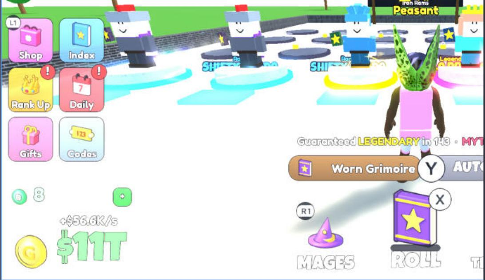

# Gamepad support

**What it is:** Controller support for a button-based HUD with pop-up windows (Xbox, PlayStation, any gamepad). It switches between gamepad and mouse/touch mode from the last input, shows controller glyphs on buttons while a gamepad is in use, gives each window a selection group, handles B to go back, and keeps the selection inside a window when the window rebuilds its buttons.

**Looks like:**

**Came from:** MageFarm, `MageFarm/src/client/Gamepad.lua`, 2026-10-26

**Parameters:**
- Mage Farm bindings: X roll, Y auto roll, LB menu (select the left menu, move with D-pad or stick, A to press), RB Mages window, B back
- `Gamepad.hint(parent, keyCode, props)`: corner glyph on a button, visible only in gamepad mode
- `Gamepad.isActive()`
- `Gamepad.init(app)`: the app table must provide `root` (the HUD ScreenGui), `currentWindowFrame()`, `closeWindows()`, `roll()`, `toggleAuto()`, `toggleWindow(name)` and `Reveal`. Gamepad sets `app.onWindowOpen` / `app.onWindowClose` for the window code to call.

**Depends on:** [[scale-ui-kit]]; services UserInputService, GuiService, ProximityPromptService

**Used in:** MageFarm, `src/client/Gamepad.lua` (HUD and Windows call it; Windows made with `createWindow` get a selection group and a B glyph automatically)

**Version:** 0.1

**Notes:**
- X is skipped while a ProximityPrompt is on screen, because X is the prompt's key.
- Consoles have no keyboard or touch, so it starts in gamepad mode there.
- Glyph registry is a strong table pruned of destroyed entries (see [[weak-tables-and-instances]]).
- Roblox selection quirks it works around are in [[gamepad-selection]].
- To reuse it, map your own actions in the binding section and give `init` an app table with the fields above.
- Tested with Studio's Controller Emulator, not a real console.
