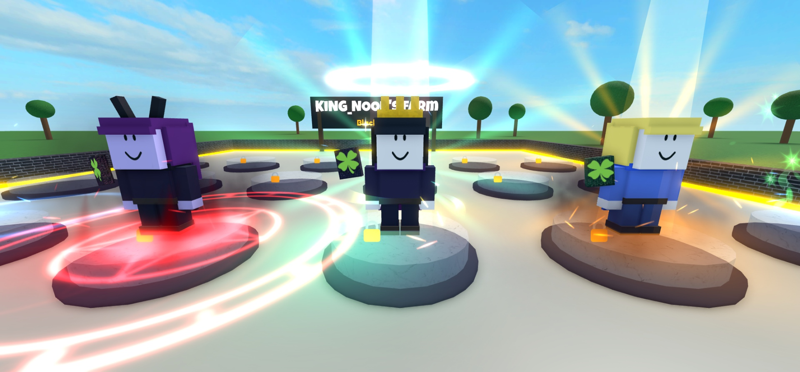

# Rarity auras

**What it is:** Client-side auras for models, layered like Sol's RNG. Each tagged model gets a stack of cheap layers for its rarity, plus an effect for its mutation. Only the nearest models get one, so a full server stays smooth.

| Rarity | Layers |
|---|---|
| Uncommon | ground glow + rising sparkles |
| Rare | + shockwave ring pulse |
| Epic | + two orbiting trails |
| Legendary | light pillar + orbiting trails + star twinkles |
| Mythic | double-helix trails + flame wisps + shockwave every 3 s |
| Captain | rotating rays + embers + dark smoke + pillar |
| Wizard King | rainbow rays + halo + rainbow trails + twinkles + pillar |
| Devil | red lightning + black flames + smoke + rune crack ring |

**Looks like:**

**Came from:** MageFarm, `MageFarm/src/client/Auras.lua`, 2026-10-23

**Parameters:**
- `Config.FX.MaxAuras` (36 in Mage Farm) and `Config.FX.AuraDistance` (140 studs from the camera)
- `Config.Rarities` / `RarityByKey` / `RarityIndex`: colors and order
- Models are found by the CollectionService tag `MageModel`, with `Rarity` and `Mutation` attributes set by the server
- `Auras.init()`, `Auras.refresh()`, `Auras.count()`

**Depends on:** `Config` from `ReplicatedStorage.Shared`; [[screen-fx]] (emitters, textures); [[sfx]]; services CollectionService, RunService

**Used in:** MageFarm, `src/client/Auras.lua`

**Version:** 0.1

**Notes:**
- The rarity names and layer recipes are Mage Farm's (`buildRarity` and `buildMutation`). Change those two functions for another game; the culling, anchoring and layer helpers are generic.
- No PointLights, ground glows at LightEmission 0.5, Brightness around 1–2 (see [[bloom-and-glow-tuning]]).
- Mage Farm's tests build all 54 rarity and mutation combos.
