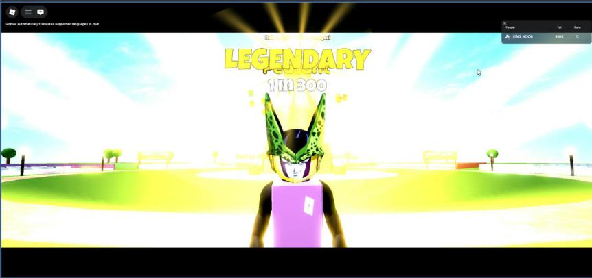

# Roll cinematic

**What it is:** Feedback for an RNG roll that gets bigger with rarity. Every roll gets a light burst at the player's feet and the name popping over their head. Epic and up add radial rays and a FOV punch. Legendary and up play a cinematic: the HUD hides, letterbox bars slide in, the camera closes in on the avatar, the world dims, and the rarity title ("LEGENDARY / 1 in 300") slams in with a white flash, shockwave, rays and camera shake. Higher tiers get longer build-ups, flickering rarity names, and for the top tier a red grade and lightning.

**Looks like:**

**Came from:** MageFarm, `MageFarm/src/client/Cinematic.lua`, 2026-10-23 (VR checks 2026-10-26)

**Parameters:**
- `Config.FX.CinematicRarity`: lowest rarity that gets the cinematic
- `Config.Rarities` / `RarityByKey` / `RarityIndex` / `MageByKey`: names, colors, odds text
- `Cinematic.wants(result)`, `Cinematic.isBusy()`, `Cinematic.feedback(result)` (small per-roll effects), `Cinematic.play(result, done)`, `Cinematic.init(app)`

**Depends on:** `Config` and `Util` (`commas`, `rarityGradient`) from `ReplicatedStorage.Shared`; [[scale-ui-kit]]; [[screen-fx]] (overlay, flash, shake, rays); [[sfx]]; services TweenService, RunService, Lighting

**Used in:** MageFarm, `src/client/Cinematic.lua` (called by Reveal before the reveal card)

**Version:** 0.1

**Notes:**
- All overlay UI is Scale only and lives in the `FXOverlay` ScreenGui.
- In VR the camera is never moved, zoomed or shaken (see [[vr-camera-safety]]).
- Rolls that get a cinematic skip the regular roll effects, or the rays fire during the build-up and blow out the close-up.
- Frame the close-up above the head (look at +2.6 studs) so the title doesn't sit on the avatar.
- The style table (`run`) is keyed by Mage Farm's rarity names; map your own tiers onto it.
