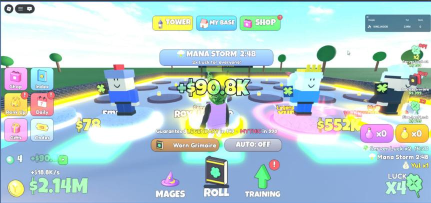

# Screen and world FX kit

**What it is:** A client-side visual effects kit: particle emitters, bursts, shockwaves, poofs, light rays, lightning bolts, coins that fly to the player, light pillars, a name that floats over the player's head, screen flashes, camera shake, FOV punch and color-grade tweens. Everything exists on this client only (nothing replicates). Camera effects are skipped in VR.

**Looks like:**

**Came from:** MageFarm, `MageFarm/src/client/FX.lua`, 2026-10-23 (VR checks 2026-10-26)

**Parameters:**
- Helpers: `FX.emitter(parent, props)`, `FX.anchor(cf, size, parent)`, `FX.trail`, `FX.beam`, `FX.light`, `FX.cleanup(inst, after)`, `FX.ns` / `FX.nr` / `FX.seq` / `FX.color` (NumberSequence, NumberRange, ColorSequence shortcuts), `FX.tex(name)`
- World: `FX.burst(pos, color, scale)`, `FX.shockwave`, `FX.poof`, `FX.rays`, `FX.bolt(a, b, color)`, `FX.coins(from, count)`, `FX.pillar`, `FX.nameFloat(root, text, rarity)`
- Screen and camera: `FX.flash(color, startTransparency, duration)`, `FX.shake(magnitude, duration)`, `FX.fovPunch(amount)`, `FX.grade(props, time)`, `FX.eventFlash(color)`, `FX.rankUp()`
- `FX.vr()`: true in VR. Check it before any camera effect.
- `FX.init(app, playerGui)`: creates the `FXOverlay` ScreenGui (DisplayOrder 20)
- Textures: `Config.FX.Textures` (12 white-on-transparent particle textures, ids in `MageFarm/notes/Game Data.md`, sources in `MageFarm/assets/fx/`)

**Depends on:** `Config` (`FX.Textures`, `RarityIndex`, `AnnounceRarityIndex`) and `Util` (`Rainbow`, `rarityGradient`) from `ReplicatedStorage.Shared`; [[scale-ui-kit]]; [[sfx]]; services TweenService, RunService, VRService, Lighting

**Used in:** MageFarm, `src/client/FX.lua` (used by Auras, Cinematic, Reveal, Ambient, HUD)

**Version:** 0.1

**Notes:**
- The rarity-related calls (`nameFloat`, `rankUp`, `eventFlash`) use Mage Farm's rarity table. Swap those for your own game, or drop them; the rest is generic.
- Keep particle Brightness around 1–2 and avoid PointLights under Bloom (see [[bloom-and-glow-tuning]]).
- Never move, zoom or shake the camera in VR (see [[vr-camera-safety]]).
