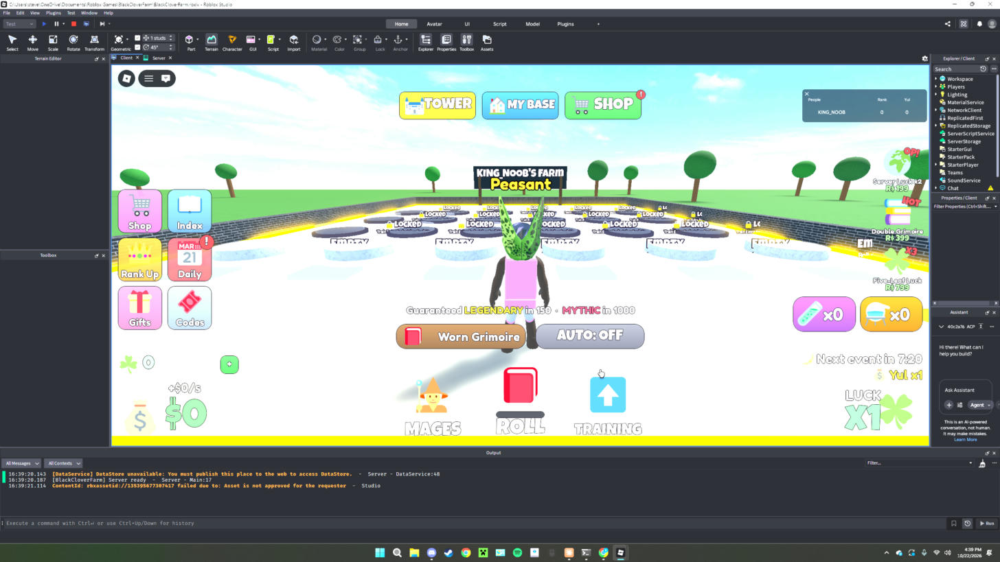

# Scale UI kit

**What it is:** A helper module (`UI.lua`) for building screen UI that keeps the same proportions on every device. Nothing in it uses Offset. Top-level groups use `SizeConstraint.RelativeYY` (sized by screen height), children size as a Scale of their parent, text is `TextScaled`, and strokes are rescaled from the screen height. It also has buttons with a click bounce and sound, red badges that wiggle, a pager for long lists, and icons that fall back to an emoji when an image id is 0.

**Looks like:**

**Came from:** MageFarm, `MageFarm/src/client/UI.lua`, built 2026-10-22 (registry fix 2026-10-27)

**Parameters:**
- `UI.new(className, props, children)`, `UI.frame`, `UI.text`, `UI.button`, `UI.icon(parent, key, props)`
- `UI.corner(parent, scale)`, `UI.stroke(parent, base, color, border)`, `UI.aspect(parent, ratio)`, `UI.gradient`, `UI.list`, `UI.grid(parent, cols, rows, gapX, gapY)`
- `UI.pager(parent, cols, rows, buildCell, props)`: pages with < > instead of a ScrollingFrame
- `UI.badge(parent)`, `UI.bounce(button)`, `UI.popIn(scale)`, `UI.clear(container)`
- `UI.rescaleStrokes()`: call when the screen size changes
- `UI.tracked()`: returns the live stroke and wiggler counts (for tests)
- Colors and fonts come from the props each call passes in.

**Depends on:**
- `Config.Icons` (key → image id) and `Config.IconEmoji` (key → fallback emoji), read from `ReplicatedStorage.Shared.Config`
- [[sfx]] (`SFX.play("click")` on buttons)
- Services: TweenService, RunService, Workspace (camera viewport size)

**Used in:** MageFarm, `src/client/UI.lua` (required by HUD, Windows, Reveal, Cinematic, FX, Gamepad)

**Version:** 0.1

**Notes:**
- The rules this kit enforces are in [[ui-scale-only]].
- The stroke and wiggler registries are strong tables pruned of destroyed entries, not weak tables keyed by Instances (see [[weak-tables-and-instances]]).
- Mage Farm's test suite has a "ui registries stay bounded" check that uses `UI.tracked()`.
