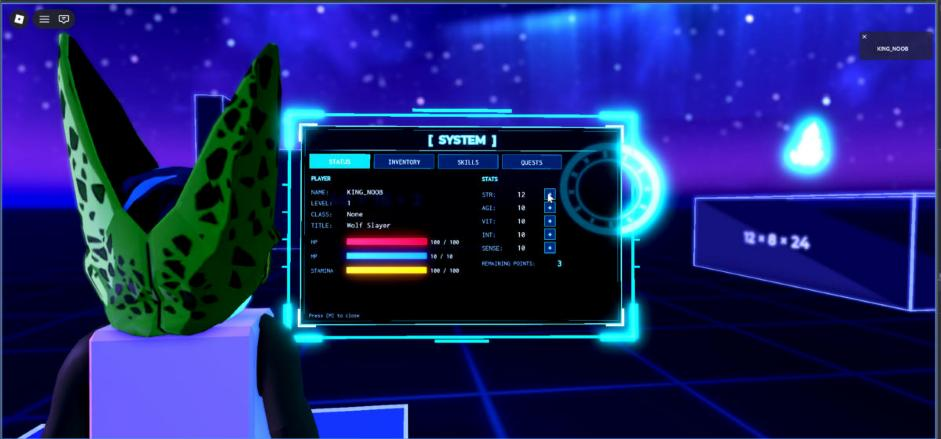
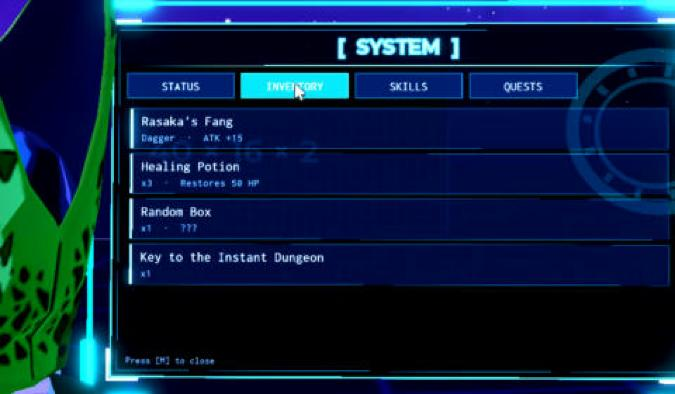

# System Window (Solo Leveling style menu)

**What it is:** A Solo Leveling-style "System" window that opens on a key (M). It isn't a screen overlay. The camera flies over the character's right shoulder to a holographic 3D panel (a Part with a SurfaceGui) standing in the world. Movement freezes while it's open. Tabs: Status (level, bars, stats with + buttons), Inventory, Skills, Quests. Opening draws a line, fires a glow burst and unfolds the window with typewriter text. Closing collapses it and puts the camera back exactly where it was. Everything is built in Luau at runtime; nothing was made by clicking in Studio.

**Looks like:**

**Came from:** Baseplate (the Sandbox place), `Baseplate/src/shared/Experiments/SystemMenu/`, 2026-10-27

**Parameters:** all in a `Config.SystemMenu` table:
- `Key` (default `Enum.KeyCode.M`)
- `Camera`: `Offset` (x right, y up, z behind), `FieldOfView`, `TweenTime`, `EasingStyle`, `Parallax.Move` / `Turn`, `Breathing`, `Blur.FarIntensity` / `InFocusRadius`
- `Panel`: `Offset` (keep x around 3.5 or the character covers it), `Size`, `PixelsPerStud`, `Tilt`, `UnfoldTime`, `CollapseTime`, `TypewriterSpeed`, `TypewriterStagger`, `Colors`, `Font`, `TitleFont`, `ScanlineTransparency`, `FrameTransparency`, `FlickerChance`, `Light`
- Content: `Player` (level, class, title, bars, stats, points), `Inventory`, `Skills`, `Quests`
- `Sounds.*.Id` / `Volume`
- Asset ids it reads from `Config.Assets`: `FrameMesh` (81557014267330), `Glow` (90205060995000), `ScanlineTexture` (85205165266271). All are uploads on lithik260, so they work in any of Steven's games.

**Depends on:**
- `Assets.lua` (included here): loads the frame MeshPart and falls back to a plain Part. `HoloPanel.lua` requires it from `ReplicatedStorage.Sandbox.Assets`, so change that line when the folder lives somewhere else.
- A config table passed in as `ctx.Config` (the Sandbox `ExperimentLoader` passes it; see [[experiment-loader]]). Without the loader, call the module's `client(ctx)` yourself with `{ Config = yourConfig }`.
- Services: Players, UserInputService, TweenService, RunService, Lighting, SoundService.

**Used in:** Baseplate, `src/shared/Experiments/SystemMenu/` (run by ExperimentLoader on the client)

**Version:** 0.1

**Notes:**
- Files: `SystemMenu/init.lua` (the ModuleScript; open/close state, input), `MenuCamera.lua` (camera flight, parallax, breathing, blur), `HoloPanel.lua` (3D panel, frame mesh, light, open/close effects), `SystemWindow.lua` (window contents), `Sounds.lua`.
- The window uses pixel Offsets (46 `UDim2.new` calls). That's fine here: it draws on a SurfaceGui with a fixed pixel canvas, so screen size doesn't change it. A game with a Scale-only rule for screen UI can still use it, since it isn't screen UI.
- The SurfaceGui sits in PlayerGui with `Adornee` set to the panel part, or its buttons get no clicks (see [[surfacegui-buttons]]).
- Movement is frozen with Humanoid WalkSpeed/JumpPower 0 and AutoRotate off, not through PlayerModule (see [[freezing-player-movement]]).
- Tested in Studio: open/close restores the camera exactly (0.000 studs, 0.00°), spamming M settles on the last state, dying while open cleans up, M is ignored while typing in a TextBox.
- Stat points spent with + last for the session only (not saved).
